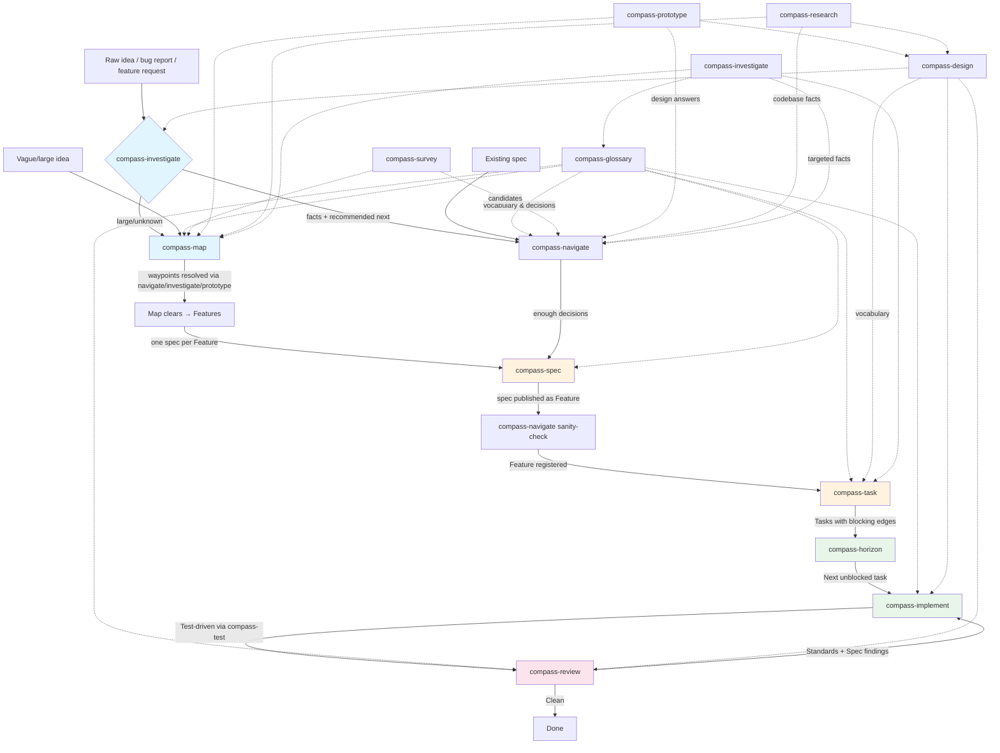

# Compass Index

Discoverable reference for the Compass skill set. No execution, no routing — just a readable map of what exists and how skills connect.

## Skills catalogue

### Pipeline skills (sequential flow)

| Skill | Consumes | Produces | Hands off to |
|-------|----------|----------|--------------|
| `compass-map` | Loose, oversized idea | Map (Epic + waypoints + Log + Features) | `compass-spec` (once per Feature) |
| `compass-navigate` | Idea/decision/plan OR existing spec | Resolved decisions (via `compass-glossary`) OR confirmed Feature | `compass-spec` / `compass-task` / `compass-glossary` / `compass-prototype` / `compass-investigate` |
| `compass-spec` | Resolved decisions (from navigate or cleared map) | Spec published as Feature | `compass-navigate` (sanity-check) |
| `compass-task` | Spec (cleared by navigate) OR plan/conversation | Task-type issues with blocking edges | `compass-horizon` |
| `compass-horizon` | Task backlog | One claimed Task | `compass-implement` |
| `compass-implement` | Task (claimed) | Working, tested code committed | `compass-review` |
| `compass-review` | Diff + originating spec | Two-axis findings report (Standards + Spec) | Back to `compass-implement` for fixes |

### Cross-cutting skills (called from anywhere)

| Skill | Consumes | Produces | Hands off to |
|-------|----------|----------|--------------|
| `compass-glossary` | Live conversation with unclear/contested terms OR hard-to-reverse decision | Structured facts/decisions in persistent memory (or CONTEXT.md + ADRs) | Nothing (writes memory only) |
| `compass-design` | Module/interface under discussion | Shared vocabulary applied in conversation | `DEEPENING.md` / `DESIGN-IT-TWICE.md` / `compass-prototype` |
| `compass-survey` | Codebase or named direction | Deepening candidates discussed in conversation | `compass-navigate` → `compass-task` |
| `compass-test` | Task slice + seam under test | Passing tests + minimal implementation | Nothing (refactoring → `compass-review`) |
| `compass-prototype` | Open question better answered by running code | Throwaway artifact + captured answer + trimmed snippet for spec | Calling skill resumes with answer |
| `compass-research` | Codebase scope | Facts committed to persistent memory | Nothing (informs design/debug) |
| `compass-investigate` | Investigation requirement (bug, code question, prior art, clarification, dependency map) | Investigation record with findings, confidence, recommended next skill | `compass-navigate` / `compass-map` / `compass-task` / `compass-glossary` / terminal |

### Reference skills

| Skill | Purpose |
|-------|---------|
| `compass-index` | This file — read-only skill listing and pipeline diagram |

## Pipeline diagram

## Quick start guide

| Your situation | Start here |
|----------------|------------|
| "I have a bug report" | `compass-investigate` (repro type) |
| "I have a vague feature idea" | `compass-navigate` (if small) or `compass-map` (if large) |
| "I have a spec from outside" | `compass-navigate` (sanity-check) |
| "I need to understand this codebase" | `compass-research` |
| "I want to refactor a shallow module" | `compass-survey` |
| "I need to decide on a design" | `compass-navigate` (+ `compass-prototype` if needed) |
| "I'm ready to implement" | `compass-horizon` (picks next task) |
| "What skill does X?" | `compass-index` (this skill) |

## Issue types reference

| Type | Created by | Tracker equivalent |
|------|------------|-------------------|
| Epic | `compass-map` | Jira Epic, GitHub/Linear `epic` label, `beads -t epic` |
| Feature | `compass-spec` / `compass-navigate` (registration) | Jira Story, GitHub/Linear `feature` label, `beads -t feature` |
| Task | `compass-task` / `compass-map` (investigate/groundwork waypoints) | Jira Task/Sub-task, GitHub/Linear `task` label, `beads -t task` |
| Decision | `compass-glossary` / `compass-map` (decide/prototype waypoints) | `beads -t decision`, or Task with "resolves a decision" note |

## Vocabulary reference

| Term | Meaning |
|------|---------|
| Waypoint | Single open question on a `compass-map` (not a Task) |
| Horizon | Open, unblocked, unclaimed items ready to pick up (waypoints or Tasks) |
| Log | Running record of resolved waypoints on a map |
| Features | Map's grouping of Log entries into independently shippable specs |
| Uncharted water | In-scope work not yet sharp enough to waypoint |
| Seam / Interface / Depth / Leverage / Locality | `compass-design` module vocabulary |

## Usage

Invoke directly: "Show me the compass index" or "Which skill for X?"

This skill produces no output files and makes no changes. It is a reference only.